# FAROL

**Un roguelike de póker para PSP.** Juega manos de póker, encadena amuletos que multiplican tu
puntuación y supera ocho mesas de tahúres cada vez más exigentes.

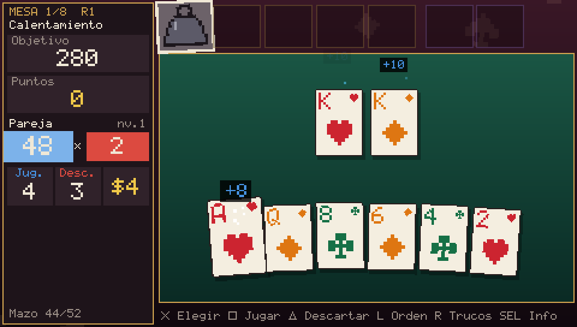

FAROL es un juego casero (*homebrew*) inspirado en Balatro, escrito en C para la PSP. Todo lo que
ves y oyes se genera por código: el repositorio no tiene ni un solo archivo de imagen o de sonido
del juego. Hasta el icono y el fondo del menú de la consola los dibuja un script al crear el ISO.

> **Estado del proyecto.** Funciona completo en el emulador PPSSPP, donde se ha probado con
> partidas automáticas. **Todavía no está confirmado en una consola real.** Si lo pruebas en tu
> PSP, abre una incidencia contando qué tal: arranque, botones, sonido y guardado.

**In English:** FAROL is a poker roguelike for the PSP, fully playable in English (*Options →
Language*). Grab `FAROL.iso` from the [Releases](https://github.com/nerontad/Farol/releases/latest)
page and copy it to the `ISO` folder of a PSP with custom firmware, or open it in PPSSPP.

## Contenido

- [Capturas](#capturas)
- [Qué ofrece](#qué-ofrece)
- [Descargar e instalar](#descargar-e-instalar)
- [Cómo se juega](#cómo-se-juega)
- [Controles](#controles)
- [Todo el contenido](#todo-el-contenido)
- [Guardado](#guardado)
- [Compilar desde el código](#compilar-desde-el-código)
- [Pruebas](#pruebas)
- [Cómo está hecho](#cómo-está-hecho)
- [Limitaciones conocidas](#limitaciones-conocidas)
- [Créditos y licencia](#créditos-y-licencia)

## Capturas

| | |
|:---:|:---:|
| 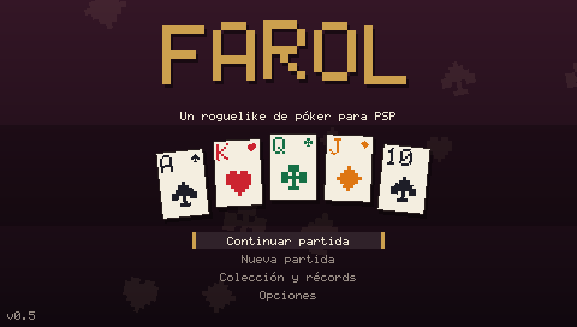 | 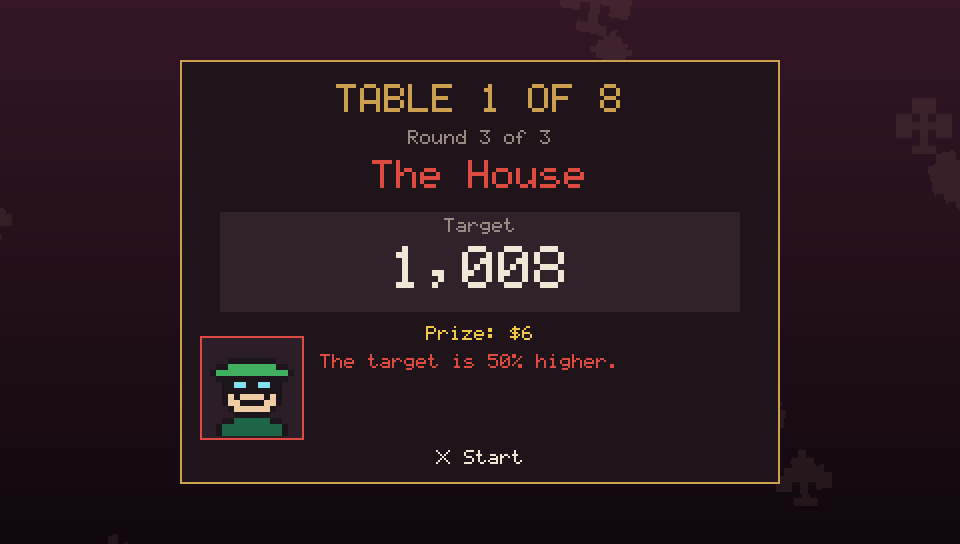 |
| El menú principal | Cada rival tiene su retrato y su regla (aquí, en inglés) |
| 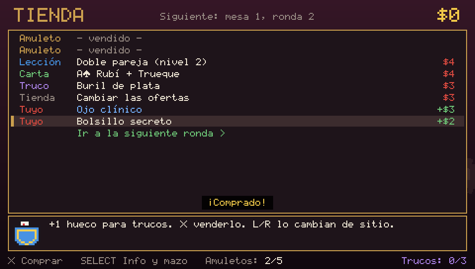 | 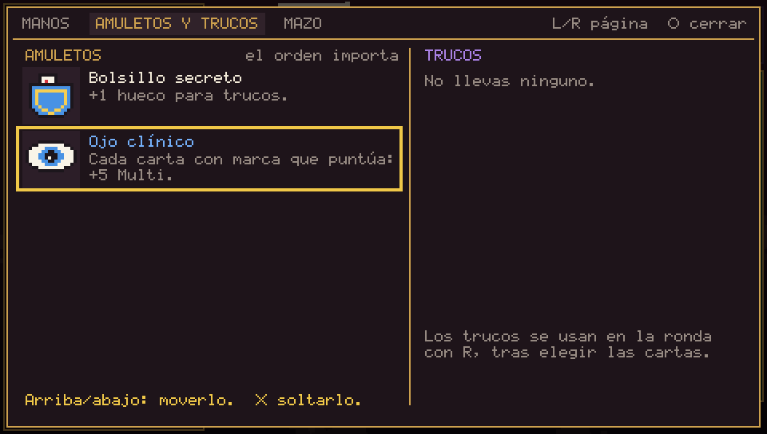 |
| La tienda entre rondas | Los amuletos se pueden cambiar de sitio: el orden importa |
| 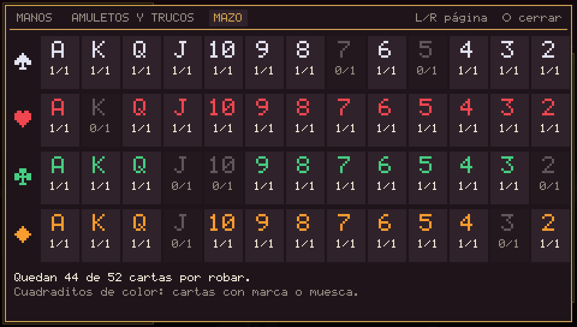 | 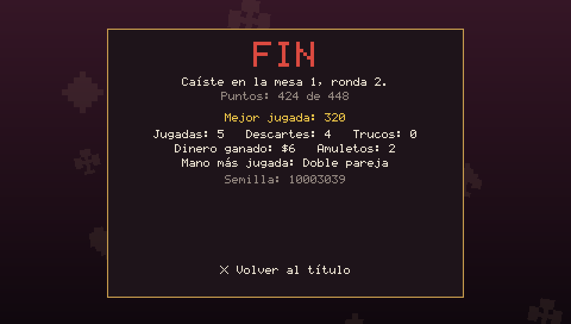 |
| Qué cartas te quedan por robar | El resumen de la partida, con su semilla |
| 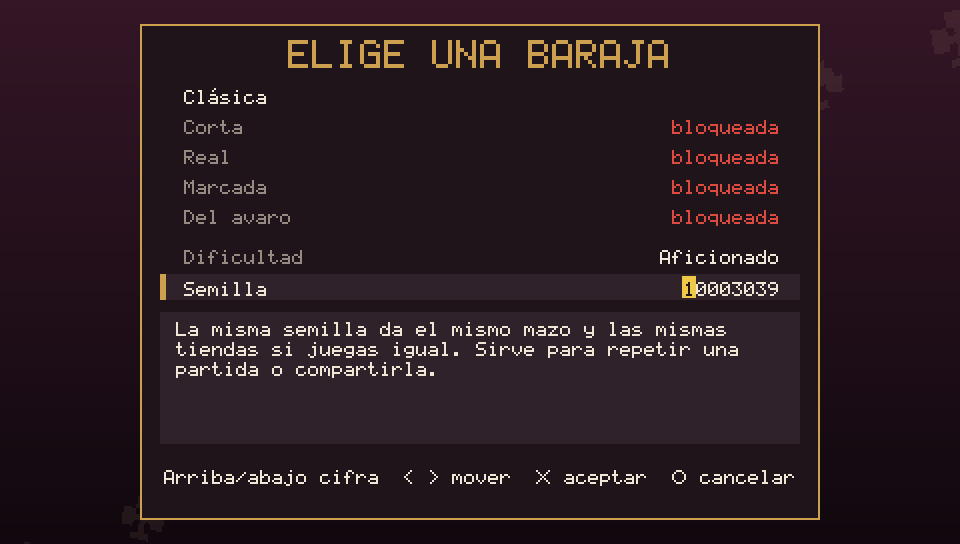 | 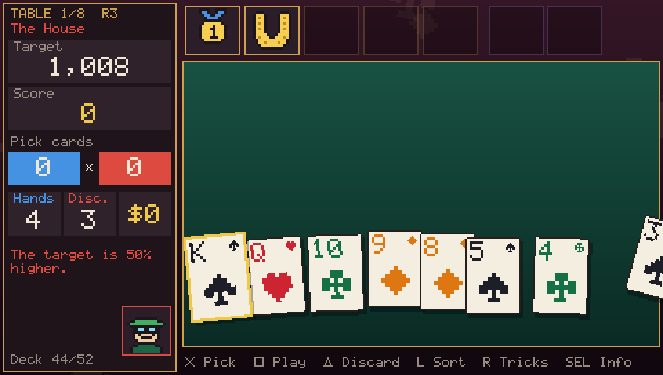 |
| La semilla, para repetir o compartir una partida | En plena ronda contra un rival (en inglés) |
| 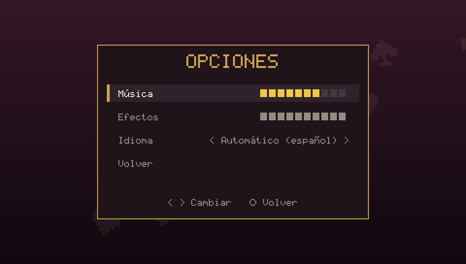 | 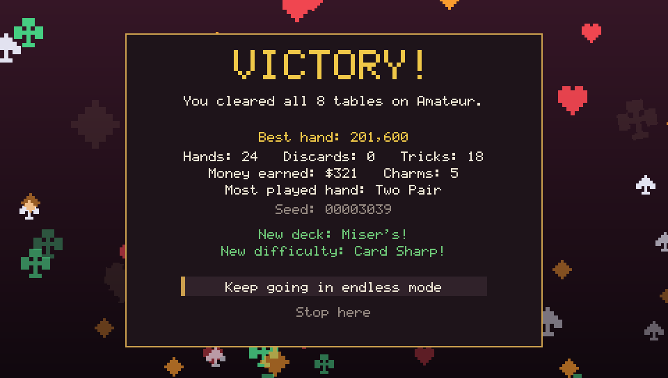 |
| Volumen de música y efectos, e idioma | La victoria, y la puerta al modo infinito |

Las 87 ilustraciones del juego, dibujadas como pixel art de 16×16: 60 amuletos, los trucos y los
17 rivales (sus caras se montan por capas: cara, sombrero, ojos y boca).

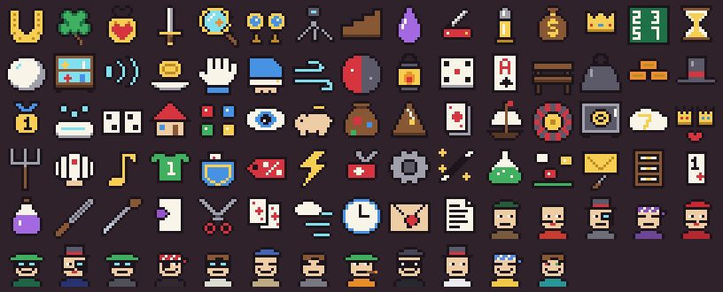

El fondo que muestra la consola al elegir el juego en su menú:

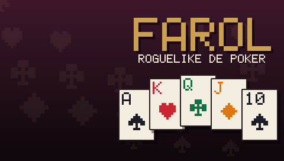

El sonido también es sintetizado. En [capturas/muestra_sonido.wav](capturas/muestra_sonido.wav)
hay una muestra de 13 segundos que recorre las cuatro piezas de música (título, partida, rival y
tienda) con un recuento que sube de tono en medio.

## Qué ofrece

- **60 amuletos** pasivos en tres rarezas, cada uno con su ilustración. Llevas hasta cinco, su
  orden importa y puedes cambiarlos de sitio cuando quieras.
- **Sinergias:** amuletos que se alimentan de los trucos que llevas o usas, de las cartas con marca
  o muesca, o de jugar una sola carta o las cinco.
- **Cartas modificables en dos capas:** una *marca* que actúa al puntuar y una *muesca* que actúa
  en otros momentos.
- **18 trucos** de un solo uso para cambiar palos, subir números, copiar o destruir cartas.
- **17 rivales** con retrato y regla propia que te obligan a cambiar de plan.
- **5 barajas** iniciales y **3 dificultades**, que se van desbloqueando.
- **Modo infinito** al superar la octava mesa.
- **Semilla:** cada partida tiene un código de 8 cifras; si lo escribes al empezar, repites la
  misma partida o la compartes.
- **Estadísticas** de cada partida y acumuladas: manos jugadas, dinero ganado, tu amuleto
  favorito...
- **Español e inglés.** Por defecto, el idioma de la consola.
- **Música que cambia según el momento** (título, partida, rival y tienda), con volumen de música y
  de efectos por separado.
- **Guardado automático** en los datos guardados de la consola, con colección y récords.
- **Animaciones y sonido con chispa:** cartas con muelle, temblor de pantalla, confeti y un
  recuento que sube de tono y se acelera con cada carta.

## Descargar e instalar

Descarga **`FAROL.iso`** (unos 800 KB) de la página de
**[Releases](https://github.com/nerontad/Farol/releases/latest)**.

### En una PSP

Necesitas una PSP con *custom firmware* (por ejemplo 6.61 PRO o ARK-4). Con el firmware oficial
no arranca.

1. Conecta la PSP al ordenador por USB.
2. Copia `FAROL.iso` a la carpeta `ISO` de la raíz de la Memory Stick. Si no existe, créala.
3. Búscalo en **Juego → Memory Stick**.

Si prefieres no usar un ISO, la misma página tiene `EBOOT.PBP`: cópialo a `PSP/GAME/FAROL/`. Es el
mismo juego.

### En un ordenador o un móvil

Abre `FAROL.iso` con el emulador [PPSSPP](https://www.ppsspp.org/).

## Cómo se juega

Cada ronda tiene un **objetivo** de puntos. Tienes una mano de 8 cartas, **4 jugadas** y
**3 descartes** para alcanzarlo.

1. Elige hasta 5 cartas de tu mano.
2. **Juégalas** como mano de póker, o **descártalas** para robar otras.
3. Cada jugada puntúa `fichas × Multi`. La mano aporta una base, y cada carta que forma parte de
   ella suma su valor en fichas (el número de la carta; J, Q y K valen 10 y el As 11).
4. Si llegas al objetivo, cobras y pasas a la tienda. Si te quedas sin jugadas, se acaba la partida.

| Mano | Fichas × Multi |
|---|:---:|
| Carta alta | 10 × 1 |
| Pareja | 20 × 2 |
| Doble pareja | 30 × 2 |
| Trío | 40 × 3 |
| Escalera | 50 × 4 |
| Color | 55 × 4 |
| Full | 60 × 5 |
| Póker | 80 × 7 |
| Escalera de color | 120 × 8 |
| Repóker | 140 × 12 |

El orden de la puntuación es siempre el mismo, y conviene conocerlo para colocar bien los amuletos:

1. Las cartas que puntúan, de izquierda a derecha.
2. Las cartas jugadas que no puntúan.
3. Las cartas que se quedan en tu mano.
4. Los amuletos, de izquierda a derecha.

Un amuleto que suma Multi rinde más **antes** de uno que lo multiplica.

**La partida** son 8 mesas de 3 rondas. La tercera ronda de cada mesa es contra un rival con una
regla especial. Los objetivos van de 280 puntos en la primera ronda a más de 200.000 contra el
rival de la octava mesa. Entre rondas visitas la **tienda**, donde gastas lo ganado en amuletos,
lecciones (suben de nivel una mano), cartas marcadas y trucos.

**El dinero:** cada ronda da un premio, más $1 por cada jugada que te sobre y $1 de interés por
cada $5 que tengas ahorrados (hasta $5).

## Controles

| Botón | En la partida | En la tienda |
|---|---|---|
| Cruceta / stick | Mover el cursor (arriba y abajo: elegir y soltar) | Moverse por la lista |
| ✕ | Elegir o soltar una carta. Mantener: acelerar el recuento | Comprar, vender un amuleto o usar un truco |
| □ | Jugar las cartas elegidas | Vender un truco |
| △ | Descartar las cartas elegidas | |
| ○ | Soltar todas las cartas | |
| L | Cambiar el orden de la mano (por número o por palo) | Sobre un amuleto tuyo: moverlo a la izquierda |
| R | Abrir los trucos | Sobre un amuleto tuyo: moverlo a la derecha |
| SELECT | Abrir o cerrar la información. L y R pasan de página | Igual |
| START | Pausa: volumen, semilla y salir al título | |

- **Usar un truco:** elige primero las cartas, pulsa R, escoge el truco y confirma con ✕.
- **Cambiar un amuleto de sitio en plena ronda:** SELECT, página de amuletos, ✕ para cogerlo,
  arriba o abajo para moverlo y ✕ para soltarlo.
- **La información** (SELECT) tiene tres páginas: los niveles de cada mano, lo que hacen tus
  amuletos y trucos, y el mazo completo con las cartas que te quedan por robar.
- **Elegir la semilla:** al empezar una partida, baja hasta *Semilla* y pulsa ✕. Arriba y abajo
  cambian cada cifra.

## Todo el contenido

<details>
<summary><b>Marcas y muescas</b></summary>

Una carta puede llevar una marca y una muesca a la vez.

| Marca | Al puntuar |
|---|---|
| Plata | +30 fichas |
| Rubí | +5 Multi |
| Cristal | ×1,5 Multi |
| Oro | Da $2 |

| Muesca | Efecto |
|---|---|
| Eco | La carta puntúa dos veces |
| Ancla | +4 Multi si se queda en la mano |
| Trueque | Da $1 al descartarla |

</details>

<details>
<summary><b>Los 18 trucos</b></summary>

| Truco | Efecto |
|---|---|
| Tinte ♠ ♥ ♣ ♦ | Convierte hasta 3 cartas al palo del tinte |
| Lima | Sube un número a hasta 2 cartas |
| Buril de plata / rubí | Pone esa marca en hasta 2 cartas |
| Buril de cristal / oro | Pone esa marca en 1 carta |
| Muesca de eco | Pone la muesca Eco en 1 carta |
| Muesca de ancla / trueque | Pone esa muesca en hasta 2 cartas |
| Cizalla | Destruye hasta 2 cartas para siempre |
| Gemelo | Copia 1 carta; la copia se queda en tu mazo |
| Soplo | +1 descarte en esta ronda |
| Prórroga | +1 jugada en esta ronda |
| Sobre lacrado | Ganas $8 |
| Chuleta | Sube de nivel tu mano más jugada |

Llevas hasta 2 trucos (3 con el amuleto Bolsillo secreto).

</details>

<details>
<summary><b>Los 17 rivales</b></summary>

| Rival | Regla | Desde la mesa |
|---|---|:---:|
| El Manco | 1 carta menos en la mano | 1 |
| El Impaciente | 1 jugada menos | 1 |
| El Tacaño | Sin descartes | 1 |
| El Supersticioso | Un palo entero no puntúa | 1 |
| El Republicano | Las figuras no puntúan | 1 |
| La Banca | Objetivo un 50 % más alto | 1 |
| El Estirado | Solo valen jugadas de 5 cartas | 1 |
| El Recaudador | Pierdes $1 por carta descartada | 1 |
| El Tuerto | La carta de más a la izquierda no puntúa | 1 |
| El Maniático | Las cartas pares no puntúan | 1 |
| El Aburrido | Repetir un tipo de mano puntúa la mitad | 1 |
| El Peajero | Cada jugada cuesta $2 | 1 |
| El Olvidadizo | Todas las manos cuentan como nivel 1 | 2 |
| El Ladrón | Tu amuleto de más a la izquierda no actúa | 2 |
| El Purista | Marcas y muescas no actúan | 2 |
| El Madrugón | La primera jugada no puntúa | 3 |
| El Daltónico | Medio mazo (un color) no puntúa | 4 |

</details>

<details>
<summary><b>Barajas y dificultades</b></summary>

| Baraja | Qué cambia | Cómo se abre |
|---|---|---|
| Clásica | Las 52 cartas de siempre | Disponible desde el principio |
| Corta | Sin doses, treses ni cuatros (40 cartas) | Llega a la mesa 2 |
| Real | Una copia extra de cada J, Q y K (64 cartas) | Llega a la mesa 3 |
| Marcada | 8 cartas empiezan marcadas, pero sales con $0 | Descubre 12 amuletos |
| Del avaro | Sales con $15, pero con 3 jugadas por ronda | Llega a la mesa 5 |

| Dificultad | Qué cambia |
|---|---|
| Aficionado | Las reglas normales |
| Tahúr | Objetivos un 30 % más altos |
| Leyenda | Objetivos un 70 % más altos, 1 descarte menos y la tienda cobra $1 más |

Ganar una partida abre la dificultad siguiente.

</details>

<details>
<summary><b>Algunos amuletos</b></summary>

Hay 60. Estos dan una idea de los tipos que existen:

| Amuleto | Efecto |
|---|---|
| Herradura | +4 Multi en cada jugada |
| Farol | Si la jugada es carta alta: ×4 Multi |
| Eco | La última carta que puntúa se cuenta dos veces |
| Banquillo | Cada figura que se queda en tu mano: +3 Multi |
| Metrónomo | Gana +1 Multi para siempre después de cada jugada |
| Pareja real | Si puntúan a la vez una K y una Q: ×2 Multi |
| Navaja suiza | Por cada truco que lleves encima: ×1,3 Multi |
| Alquimista | Las cartas con marca puntúan dos veces |
| Carambola | Si puntúan las 5 cartas jugadas: ×2,5 Multi |
| Solitario | Si juegas una sola carta: ×3 Multi |

El resto se descubre jugando: la colección del menú principal guarda los que ya has comprado.

</details>

## Guardado

La partida se guarda sola al empezar cada ronda y al entrar en la tienda. Si apagas la consola a
mitad de una ronda, al continuar vuelves al principio de esa ronda.

Usa los datos guardados del sistema: aparece en **Juego → Datos guardados** como "FAROL"
(carpeta `PSP/SAVEDATA/FARL000010000`). Ahí están también los récords, las estadísticas, la
colección, lo desbloqueado y las opciones; para empezar de cero, bórralo desde ese menú.

## Compilar desde el código

Hacen falta el toolchain [pspdev](https://pspdev.github.io/) y Python 3.

```bash
git clone https://github.com/nerontad/Farol.git
cd Farol
python tools/mkiso.py --images build
make
python tools/mkiso.py farol.prx FAROL.iso
```

El primer paso dibuja el icono y el fondo del menú de la consola para el `EBOOT.PBP`; el último crea
el ISO, que los genera por su cuenta.

En Windows, con Docker Desktop abierto, basta con ejecutar el script incluido, que usa la imagen
oficial `pspdev/pspdev`:

```powershell
.\build.ps1
```

El resultado es `FAROL.iso` y también `EBOOT.PBP`. Ninguno de los dos se guarda en el repositorio:
se publican en [Releases](https://github.com/nerontad/Farol/releases).

## Pruebas

Las reglas no dependen de la consola, así que se compilan y se prueban en un ordenador. Incluye
partidas enteras jugadas por un bot con cada baraja:

```bash
gcc -O2 -Wall -Isrc tests/test_game.c src/game.c src/save.c -o test_game && ./test_game
```

El sintetizador también se prueba en PC y deja un WAV para escucharlo:

```bash
gcc -O2 -Wall -Isrc tests/test_synth.c src/synth.c -o test_synth && ./test_synth muestra.wav
```

Para probar el juego real hay un **modo de autoprueba**: un bot maneja el juego a través de la
interfaz, como si pulsara los botones, y el propio juego guarda capturas en la Memory Stick
(`ms0:/farol_*.raw`, 480×272 en RGBA).

| Orden | Qué hace |
|---|---|
| `make clean && make AUTOTEST=1` | Una partida completa en español, con la semilla elegida a mano |
| `make clean && make AUTOTEST=2` | Se detiene en la primera tienda y deja la partida guardada |
| `make clean && make AUTOTEST=3` | Lee ese guardado, elige "Continuar" y comprueba dónde aparece |
| `make clean && make AUTOTEST=4` | En inglés: gana todas las rondas, victoria y dos mesas de modo infinito |

En PPSSPP hay que activar el renderizado por software para que las capturas no salgan en negro.
Después, `make clean && make` vuelve a la versión normal.

## Cómo está hecho

Unas 6800 líneas de C, sin más dependencias que el SDK de la PSP.

| Archivo | Qué contiene |
|---|---|
| `src/game.c` | Las reglas y todos los textos del juego en los dos idiomas. No depende de la PSP |
| `src/save.c` | Perfil, estadísticas y partida guardada, con suma de comprobación |
| `src/savedata.c` | Guardado en la consola (datos guardados del sistema, con archivo de respaldo) |
| `src/ui.c` | Pantallas, animaciones y flujo de la partida |
| `src/gfx.c` | Dibujo 2D sobre `sceGu`: rectángulos, texto, ilustraciones, giro y escala |
| `src/synth.c`, `src/audio.c` | Sintetizador de efectos y de las cuatro piezas de música |
| `src/art.h` | Ilustraciones, generadas desde `tools/art.txt` |
| `src/autotest.h` | El bot del modo de autoprueba |
| `tools/mkiso.py` | Genera `PARAM.SFO`, el icono, el fondo y la imagen ISO, solo con la biblioteca estándar |
| `tools/mkart.py` | Convierte las ilustraciones de texto en código |

### Los amuletos son datos

Cada amuleto es una fila de una tabla, con su nombre y su descripción en español e inglés y hasta
dos reglas del tipo *cuándo / condición / efecto*:

```c
{ { "Herradura", "Horseshoe" },
  { "+4 Multi en cada jugada.", "+4 Mult on every hand." }, 4, RAR_COMMON,
  { { W_END, C_ALWAYS, 0, E_MULT, 4 } } },
```

Esa fila dice: al final de la jugada (`W_END`), siempre (`C_ALWAYS`), suma 4 de Multi (`E_MULT, 4`).

Para añadir uno:

1. Añade su identificador al final de la lista de amuletos en `src/game.h`, antes de `R_COUNT`.
2. Añade su fila en `RELIC_INFO`, en `src/game.c`, en la misma posición.
3. Dibuja su icono en `tools/art.txt`, justo antes de los iconos de trucos (`t_...`), y ejecuta
   `python tools/mkart.py`.
4. Sube `SAVE_VERSION` en `src/save.c`: el guardado reserva espacio por amuleto y cambia de tamaño.

### Las ilustraciones son texto

Cada icono son 16 filas de 16 letras, donde cada letra es un color de la paleta:

```
= herradura
................
..kkk......kkk..
.kyyyk....kyyyk.
.kyYyk....kyYyk.
```

Los retratos de los rivales se montan por capas (`b_cara`, un sombrero, unos ojos y una boca), y
el juego pinta encima el color de la ropa de cada uno.

`python tools/mkart.py vista.png` las valida, genera `src/art.h` y una hoja de vista previa.

## Limitaciones conocidas

- **Sin probar en consola real.** Arranque, mando, sonido y guardado solo están verificados en PPSSPP.
- **Dificultad por afinar.** En la v0.5 los objetivos subieron en todas las mesas (las últimas
  piden más del doble que antes) porque las primeras partidas resultaron demasiado fáciles. Falta
  ajustarla con más jugadores.
- **Sin tutorial.** El juego no explica las reglas más allá de la pantalla de información.

## Créditos y licencia

FAROL es un juego inspirado en Balatro, pero no es Balatro: su código, sus reglas concretas, sus
textos, sus ilustraciones y su sonido se hicieron para este proyecto. Pertenece al género de los
roguelikes de construcción de mazos con manos de póker, pero no es un port ni una copia de ningún
juego comercial, ni está afiliado a ninguno.

Compilado con el toolchain libre [pspdev](https://github.com/pspdev/pspdev). PSP es una marca de
Sony Interactive Entertainment, que no tiene relación con este proyecto.

Publicado con la [licencia MIT](LICENSE): puedes usar, modificar y redistribuir el código siempre
que conserves el aviso de copyright.
